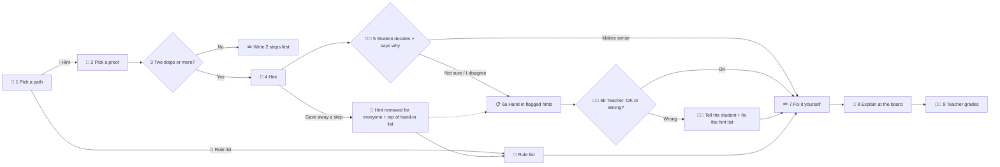

# 🗺️ Build Plan: The Hint Helper (Week 4)

🧭 [🌸 Start](../00%20Start%20Here.md) · [🗺️ Map](../01%20MATH%20140%20Course%20Map.md) · 👥 People · [⚠️ Risks](../01%20Build/02%20Stakeholders%2C%20Risk%20%26%20Evidence.md) · [💧 Hint Helper](../01%20Build/03%20Proof%20Check%20Tool%20%26%20Build%20Log.md) · [📝 M2 Plan](../01%20Milestones/M2%20Responsible%20AI%20Use%20Proposal.md) · [🧪 Build](../05%20Build%20%28M3%29/00%20How%20the%20Build%20Works.md) · [📗 Guide](../01%20Build/00%20Garden%20Guide%20%28live%29.md)

> [!NOTE]
> 📖 **What this page is:** our **1-page build plan** for Session 7, *Plan the Build*. It has the 5 parts the class asks for:
> 1. a purpose sentence
> 2. the smallest version
> 3. an input-to-output step map
> 4. named human decision points
> 5. a first test
>
> 📏 **Class rule:** *"Plan before you build. Every AI step needs a person on the far side of it, with a name."*

🏷️ **Labels:** 🔬 **evidence** (we checked it) · 🤔 **guess** (not checked yet) · 🧪 **test** (how we will check it)

---

## 1️⃣ Purpose sentence
> 🎯 **The Hint Helper lets a MATH 140 student who has written at least 2 steps of their own proof get 1 hint about the first weak step. The student decides if the hint makes sense and fixes the proof alone. Only the teacher grades.**

## 2️⃣ The smallest version
The smallest thing that still shows **what it does** and **who decides at each step**.

- 🖱️ **Form:** 1 clickable practice page. It runs in the browser. Why: see [06 Two Ways to Build It](../05%20Build%20%28M3%29/06%20Two%20Ways%20to%20Build%20It.md).
- ✅ **In it:**
  1. 2 paths: 💧 hint, or 📗 rule list (no AI)
  2. 4 made-up practice proofs
  3. 1 pretend hint for each proof, labeled **"Simulated hint"** and **"This hint could be wrong."**
  4. The decide step: **Makes sense / Not sure / I disagree**, plus a reason of 10 letters or more
  5. The teacher's list for unsure hints, with a **"Copy for my teacher"** button. It shows the text to hand in. Nothing is sent.
  6. The stop button: **"Gave away a step"**. It takes that hint off the list for everyone.
  7. A few fixed question buttons (for example, "What kind of rule should I look up?") instead of a typed Ask box
  8. Start over
- 🚫 **Not in it:**
  - real AI
  - logins
  - real student work
  - saving or sending anything
  - grades
  - a real teacher inbox
- 🔒 **Data:** nothing that you type is saved or sent. 🔬 *(evidence: Oct 6 checks 15–16)*

## 3️⃣ Step map: input to output
Each step names **who acts** and **who decides**. The 🤖 AI never decides.

| # | Step | 📥 In | 📤 Out | 🤖 / 🧑 Who acts | 🧑‍⚖️ Who decides |
|---|---|---|---|---|---|
| **0** | Pick the trial assignment | The course plan | 1 assignment where the helper is allowed | 🧑‍🌾 Teacher | 🧑‍🌾 **Teacher** *(decision point E)* |
| **1** | Pick a path | The student opens the page | 💧 Hint path or 📗 rule list | 🧑‍🎓 Student | 🧑‍🎓 **Student**: if AI is used at all. Both paths are graded the same. |
| **2** | Pick a proof | 4 made-up proofs | 1 proof on screen | 🧑‍🎓 Student | 🧑‍🎓 Student |
| **3** | 2-step check | The proof | Go on, or "Write 2 steps first" | 📏 The page's rules (code) | The rule is fixed in code. **No AI.** |
| **4** | Hint | The proof | 1 hint about the first weak step, plus 1 question | 🤖 Pretend helper | **Nobody yet.** The hint is only a suggestion. |
| **5** | 🤔 Decide | The hint | Makes sense / Not sure / I disagree, plus a reason | 🧑‍🎓 Student | 🧑‍🎓 **Student** *(decision point A)* |
| **6a** | Hand in flagged hints | Not sure and I disagree hints | Text from **"Copy for my teacher"**, handed in with the draft through the usual course hand-in | 🧑‍🎓 Student | 🧑‍🎓 Student |
| **6b** | Teacher check | The handed-in hints | Each hint marked **OK** or **Wrong**. If Wrong: the student is told, and the hint is fixed or removed. | 🧑‍🌾 Teacher, then 👥 hint-list teammate | 🧑‍🌾 **Teacher**, within 2 days, before the board talk *(decision point B)* |
| **7** | Fix it yourself | The proof and the student's own thinking | The new proof. The fix screen does **not** show the hint. | 🧑‍🎓 Student | 🧑‍🎓 **Student**: every step. The page can't check this; the board talk does. |
| **8** | Explain at the board | The new proof | A live explanation, with no AI | 🧑‍🎓 Student + 🐝 partner | 🧑‍🌾 **Teacher** *(decision point C)* |
| **9** | Grade | Proof and explanation | A grade | 🧑‍🌾 Teacher | 🧑‍🌾 **Teacher only** |
| 🛑 | Stop | The hint gave away a step | **That hint is removed for everyone.** It goes at the top of the hand-in list, marked 🛑. | 🧑‍🎓 Student presses it | 🧑‍🌾 **Teacher** approves a rewrite, or keeps it off *(decision point D)* |
| 🚫 | Refuse | The student wants more than a hint | There is no typed question. The student picks from fixed question buttons, which have no "grade me" or "write a step" choice. | 📏 The page (code) | Fixed in code. **No real AI** until it passes the 20-try test. |
| 📗 | Rule list | The student picks the no-AI way, or the helper is broken | The same fix step and board talk | 🧑‍🎓 Student | 🧑‍🎓 Student. Graded the same. |

## 4️⃣ Named human decision points
A **decision point** = a **named person** sees the AI's output and decides: **keep it, rewrite it, or reject it**.

| | Decision point | 👤 Named person | They see | They decide | Before |
|---|---|---|---|---|---|
| **A** | Is the hint any good? | 🧑‍🎓 The student using it | The hint | **Keep** (Makes sense) · **Question** (Not sure) · **Reject** (I disagree), plus why | Fixing the proof |
| **B** | Was the hint wrong? | 🧑‍🌾 `[MATH 140 teacher's name]` | Every handed-in Not sure and I disagree hint, with the student's reason | **OK** or **Wrong**. If Wrong: tell the student, and the student isn't marked down for following it. | The board talk (within 2 days) |
| **C** | Is the proof the student's own? | 🧑‍🌾 `[MATH 140 teacher's name]` | The live board explanation | If the student can explain every step | The grade |
| **D** | What happens after a stop? | 🧑‍🌾 `[MATH 140 teacher's name]` | The 🛑 hint at the top of the hand-in list | Approve a rewrite, or keep the hint off | Any student sees that hint again |
| **E** | Is the AI used at all? | 🧑‍🌾 The teacher picks the 1 trial assignment · 🧑‍🎓 each student opts in | The "Before you use the hint helper" box | Hint helper or rule list (graded the same) | Step 1 |
| **F** | Is the hint list right? | 👥 `[teammate in charge of hints]` | All pretend hints, plus every hint the teacher marked Wrong | Rewrite or delete each Wrong hint, then send it to the teacher | Any student sees it |

> [!IMPORTANT]
> ✏️ **Fill in the names.** The class rule says each AI step needs a person **with a name**. Our notes don't name the teacher yet. The interview gave **Patrick Bahls** (associate chair, Arnold Hall) as a contact. Check who the real teacher for this section is.

## 5️⃣ First test
We test the **safeguard that is still broken** first. If the form cannot keep a safeguard, the form is wrong, not the safeguard.

| | |
|---|---|
| 🧪 **Test** | **The stop stays after Start over.** |
| 🎯 **Checks** | Decision point **D**: only the teacher can turn the helper back on. |
| 🪜 **Steps** | 1. Pick a proof. 2. Get the hint. 3. Press **"Gave away a step"**. 4. Press **Start over**. 5. Pick the same proof. |
| ✅ **Pass if** | The stopped hint is gone for that proof, and the teacher's list still shows it at the top, marked 🛑. |
| ❌ **Today** | **Fails.** Start over brings the helper back. 🔬 *(evidence: Oct 6 checks)* |
| 🛠️ **Fix before re-testing** | **Stop the hint, not the student.** The stop takes that hint off the list. Start over only clears the student's work, so it can't bring the hint back. Only the teacher's OK (decision point D) does. |
| ⚠️ **Honest limit** | The prototype saves nothing, so **reloading the page** resets everything, including stops. A real version would keep the removed-hint list with the team, not in the browser. |
| 👤 **Who runs it** | `[teammate]`, with real clicks and no code shortcuts |

**🔜 Tests after that:**
1. 🐝 **Another team uses it alone.** Write down where they get stuck. ⬜ Not run.
2. 🔊 **Screen reader:** can every part be read with VoiceOver or NVDA? ⬜ Not run.
3. 💧 **20 tries to trick it** into writing a step. Pass only if it never does. ⬜ Not run (only 3 tries with the real AI on Oct 1).

---

## 🐝 Walk through it with another team
Read the step map out loud to another team. Ask them to point at anything they cannot picture.

| Question to ask them | What they said | Change we made |
|---|---|---|
| Can you say what it does in 1 sentence? | | |
| At each step, who is in charge? | | |
| Where does the AI decide anything? *(right answer: nowhere)* | | |
| What happens if the hint is wrong? | | |
| What does a student with no computer do? | | |

### ✅ Vague steps we fixed (Oct 8)
Our rule for the fixes: **use people and routines the class already has.** Don't build new tech that collects data.

| # | It was vague | Our fix | Where in the plan |
|---|---|---|---|
| **1** | **How** does a hint reach the teacher? | No new inbox. A **"Copy for my teacher"** button shows the flagged hints. The student hands them in with the draft through the usual course hand-in. `[Teacher]` reads them within 2 days, before the board talk. Nothing new collects data (safety rule 5). | Step 6a |
| **2** | What does the teacher do with a wrong hint? | The teacher marks each hint **OK** or **Wrong**. If Wrong: the student is told before the board talk, isn't marked down for following it, and `[teammate]` fixes or removes the hint. Each Wrong counts toward the "teacher checks 20 hints" test. | Step 6b · decision points B, F |
| **3** | "Fix it yourself" can't be checked. | We say so plainly. The fix screen doesn't show the hint, so it can't be copied. `[Teacher]` checks that the proof is the student's own at the board talk. | Step 7 · decision point C |
| **4** | How is the teacher told about a stop? | The same hand-in, with 🛑 hints at the top. **The hint is stopped, not the student**: it's removed for everyone until the teacher approves a rewrite. This also fixes the Start over hole. | 🛑 Stop · decision point D · first test |
| **5** | The word filter is weak. | While the hints are pretend: **no typed questions**, only fixed question buttons. For real AI: **no real AI goes live** until it passes all 20 tries to make it write a step. | 🚫 Refuse · smallest version |
| **6** | Optional for everyone, or a trial? | What the professor said: **optional, on 1 trial assignment**. The teacher picks the assignment; each student picks the helper or the rule list; both are graded the same. **The trial stops if the administration doesn't approve it.** | Step 0 · decision point E |

---

## 📋 Decision and test log (for the Transparency Log)
| Date | Claim or decision | 🔬 Evidence or 🤔 guess | Proof or 🧪 test |
|---|---|---|---|
| Oct 1 | The real helper says no when pushed to write steps. | 🔬 Evidence (3 tries) | [03 Proof Check Tool & Build Log](../01%20Build/03%20Proof%20Check%20Tool%20%26%20Build%20Log.md) |
| Oct 1 | 1 real hint was too exact (named CPCTC). | 🔬 Evidence | Hint rewritten. See [05 Tests and Decisions](../05%20Build%20%28M3%29/05%20Tests%20and%20Decisions.md), decision 4. |
| Oct 6 | Done stays locked until a choice and a reason. | 🔬 Evidence (AI-run check) | Check 1 |
| Oct 6 | Nothing typed is saved or sent. | 🔬 Evidence (AI-run check) | Checks 15–16 |
| Oct 6 | Stop survives Start over. | ❌ **Fails** | First test above |
| — | Our hints are the right size. | 🤔 Guess | Teacher checks 20 hints |
| — | Students say "Not sure" honestly. | 🤔 Guess | Compare marks with the teacher's check |
| — | The teacher has time to check hints within 2 days. | 🤔 Guess | Ask the teacher after 1 week of the trial |
| — | Hints help more than answers. | 🔬 Evidence (Bastani 2025) | — |
| Oct 8 | A person must decide each step; the build plan names who. | ✅ Decision | This page |
| Oct 8 | Flagged hints reach the teacher through the usual course hand-in, not a new inbox. | ✅ Decision | Not built yet: "Copy for my teacher" button |
| Oct 8 | A stop removes the hint for everyone, not just for 1 student. | ✅ Decision | First test |
| Oct 8 | Fixed question buttons replace the typed Ask box. | ✅ Decision | Not built yet |
| Oct 8 | The helper is optional, on 1 trial assignment the teacher picks. | ✅ Decision (from the professor interview) | — |
| — | The teacher will mark hints OK or Wrong within 2 days. | 🤔 Guess | Ask the teacher before the trial |

> [!TIP]
> 🔗 **Related:**
> - [05 Stakeholder Snapshot](../01%20Build/05%20Stakeholder%20Snapshot.md)
> - DIGI 230 1/01 Milestones/M2 Responsible AI Use Proposal
> - DIGI 230 1/05 Build (M3)/01 PRD - What We're Making
> - DIGI 230 1/05 Build (M3)/02 ARD - How the Pieces Fit
> - DIGI 230 1/05 Build (M3)/06 Two Ways to Build It (the Session 8 form comparison)
